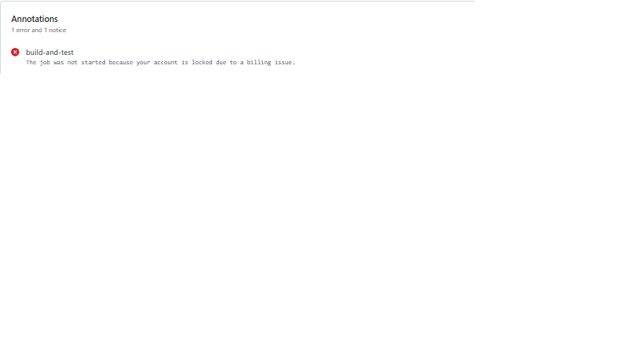

## Part 3 status

**Completed:** API additions for the front end (event filters, organiser "my events" endpoint with enrolment counts, finisher totals on results), Azure Blob Storage upload code with banner and profile picture columns and migration, the `RaceDay.Web` MVC project with session and API client setup, and a Dockerfile.

**Not completed:** the MVC pages (login, dashboards, enrolment) and the end-to-end Blob upload demo, because of time. Known issue: some unit tests fail on this branch after the Blob storage commit; Part 2 on `master` is green.

**Run with Docker:**
`docker build -t raceday-web . && docker run -p 8080:8080 raceday-web`

**Video:** TO BE ADDED

**AI disclosure:** I used an AI assistant (Claude) to help plan and draft code, tests and documentation, and I ran and committed it myself.

## CI status for Part 3

GitHub Actions currently cannot start jobs on my account. Every run since 9 November fails within seconds with the message "The job was not started because your account is locked due to a billing issue", before any of my code runs. My GitHub billing page shows a Free plan with $0 billable usage and no payment due, and I have contacted GitHub support to unlock the account.

The workflow file (`.github/workflows/ci.yml`) has not changed since Part 2, where it ran green (see the screenshots above). It restores, builds the whole solution, which now includes `RaceDay.Web`, and runs the unit tests on every push.